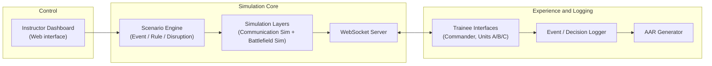
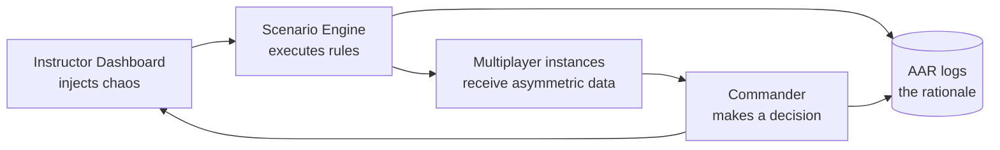

<div align="center">

# Degraded Decision Simulator

### Adapting to the Fog of War

*A dynamic decision-making simulator for degraded information environments.*


</div>

---

## Overview

Military commanders rarely lose because they cannot follow a plan. They lose because the information the plan depends on stops being reliable: links drop, feeds lag, sensors fail, and two units report two different positions for the same enemy.

**Degraded Decision Simulator** is a web-based training simulator for small-team and sub-unit commanders. It puts a commander and their team into a battlefield scenario, then deliberately degrades their communication and information systems mid-exercise. It then records *how* they decide, and not just *what* they decide.

Built for **Smart India Hackathon 2026**, Problem Statement **SIH26248**: *Immersive Multi-Domain Decision-Making Trainer for Degraded Communication Environments* (Ministry of Defence, Software).

> **The core paradigm:** the system doesn't test whether the commander can follow a plan. It tests whether the commander can adapt when the information required to follow that plan becomes unreliable.

---

## What Makes This Different

This is not a standard wargame. The objective, the information model and the win condition are all different.

| | Standard War Game | Degraded Decision Simulator |
|---|---|---|
| **Primary objective** | Follow the plan | **Adapt to failure** |
| **Information state** | Perfect / symmetric information | **Degraded / asymmetric information** |
| **Win condition** | Destroy the enemy | **Good decision rationale under uncertainty** |
| **Role of cyber** | Standalone module / goal | **Mechanism for information disruption** |

---

## Anatomy of a Degraded Decision

```
Scenario start ──► Enemy activity detected ──► EW attack triggered
        │
        ▼
Comm delayed / drone feed unavailable ──► Two units report conflicting positions
        │
        ▼
                 ┌──────────────────────┐
                 │  COMMANDER MUST DECIDE │
                 └──────────────────────┘
        │
        ▼
Another disruption occurs ──► Commander adapts
```

Every exercise follows this shape: normal communication at the start, escalating interference, a forced decision on incomplete data, and then another disruption that tests whether the commander can keep adapting.

### The Disruption Funnel

Cyber and electronic-warfare effects are modelled as a chain from cause to consequence:

| Stage | Description |
|---|---|
| **Trigger** | Cyber attack / EW interference |
| **Mechanism** | Communication system compromised |
| **Symptom** | Delayed or incorrect information hits the network |
| **Outcome** | Commander is forced to decide on degraded data, and the system evaluates the rationale |

### The Interference Matrix

| Category | Disruption types |
|---|---|
| **Environmental** | Changing battlefield events · Missing reports |
| **Adversarial / Technical** | Cyber disruption · Electronic warfare (EW) interference |
| **Systemic / Sensor** | Communication delay (e.g. 30 s lag) · Communication dropout · False / conflicting reports · Sensor failure |

---

## Core Components

### 1. Scenario Engine
The heart of the project. A dynamic ruleset engine that doesn't just play a script, but algorithmically injects chaos.

- **Event Generator**: produces battlefield events
- **Rule Engine**: governs which events and disruptions apply, and when
- **Disruption Engine**: turns those rules into interference variables (`INJECT_INTERFERENCE_VARIABLES`) that flow into the simulation

### 2. Multiplayer Team Coordination
Several trainees share one battlefield, but the system intentionally starves or corrupts each trainee's individual information stream. The simulation holds a single **ground truth**; each screen receives its own version of it.

| Screen | What it receives (example) |
|---|---|
| Commander | Enemy at Location A (accurate) |
| Unit A | Enemy at Location A (accurate) |
| Unit B | Enemy at Location B (corrupted) |
| Unit C | Signal delayed by 30 s |
| Drone feed | No signal |

The commander has to reconcile these conflicting views, deciding whom to trust, what to verify and when to act anyway.

### 3. Real-Time Instructor Dashboard
The instructor manipulates scenario conditions **live** while the exercise is running.

- **Status metrics:** EW intensity, communication state, drone feed state, GPS accuracy
- **Live injects:** `Inject EW Attack` · `Drop Communication` · `Create Conflicting Report` · `Restore Communication`

### 4. After Action Review (AAR)
Every event and decision is logged and turned into a structured review:

- **Raw log:** timestamped events and orders

  ```
  10:02:15  Enemy detected
  10:02:48  Communication degraded
  10:03:41  Conflicting reports received
  10:04:05  Commander orders Unit B to reposition
  ```

- **Evaluation output:** overall decision-making score, response time, and ratings for information verification, risk management and team coordination
- **Critical review:** which report the commander chose, the stated **rationale** (e.g. "supported by two independent sources"), and the **outcome**
- **Export:** individual and team decision timelines with rationale

---

## System Architecture



### The Evaluation Loop

The prototype is not a linear game. It is a closed-loop engine designed to extract and measure human decision-making rationale under duress.



---

## Scope and Safety

- Scenarios are **abstract and synthetic**. The simulator runs without any classified or operational military data.
- Coordinates, unit names and values shown in the interface are illustrative placeholders.
- The goal is to train judgement under uncertainty, not to model real weapons systems or real-world operations.

---

## Getting Started

<!-- TODO: fill in once the stack and folder structure are final -->

```bash
# 1. Clone the repository
git clone https://github.com/<your-username>/<repo-name>.git
cd <repo-name>

# 2. Install dependencies
# TODO

# 3. Start the simulation server
# TODO

# 4. Open the instructor dashboard and trainee interfaces
# TODO
```

---

## Roadmap

- [ ] Scenario Engine: event generator, rule engine, disruption engine
- [ ] Communication and battlefield simulation layers
- [ ] WebSocket server with per-trainee asymmetric data streams
- [ ] Trainee interfaces (Commander, Units A/B/C)
- [ ] Real-time instructor dashboard with live injects
- [ ] Event / decision logger
- [ ] AAR generator with scoring and exportable timelines

---

## Team

Built by **Team Synthetix** for Smart India Hackathon 2026.

<!-- TODO: add team members -->

---

## License

<!-- TODO: choose a license -->
